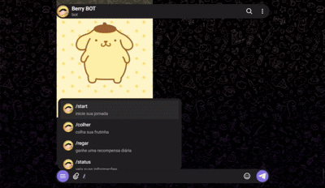
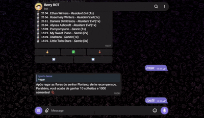
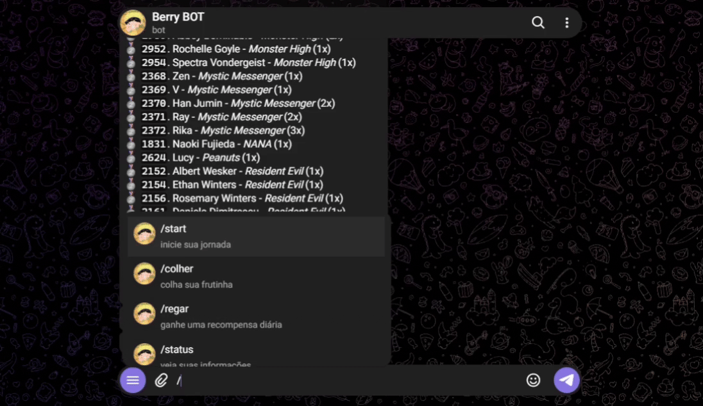
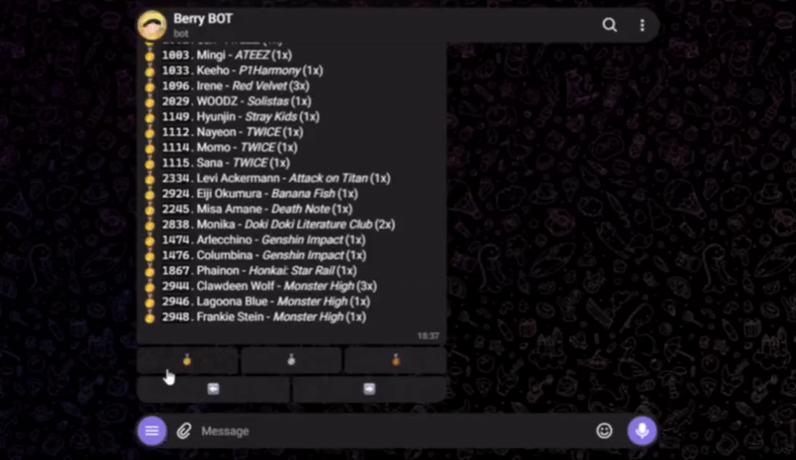

# 🍓 BerryBot — Telegram Card Collection Game

BerryBot is an interactive Telegram bot developed as a freelance project using **Python, Aiogram, and MySQL**. It allows users to **collect, trade, and sell cards** featuring characters from anime, K-pop, cartoons, and other categories.

The bot combines gacha-style game mechanics with inventory management and an in-game economy, featuring its own currency system used to purchase items and exclusive benefits.

Its visual theme is inspired by the animated series *Strawberry Shortcake: Berry in the Big City* (Moranguinho: Aventuras na Vila Tutti-Frutti), where collectible cards are represented as little fruits (*frutinhas*) and the in-game currency is represented as seeds.

## 🎮 Demo

### Card Spinning
<p align="center">
  
</p>

### User Profile
<p align="center">
  
</p>

### Daily Bonus Spins
<p align="center">
  
</p>

### Card Inventory
<p align="center">
  
</p>

## 🍉 Key Features

- **Daily Spins:** Players can obtain random cards based on category and rarity.
- **Rarity System:** Cards are classified into three rarity levels: Common, Rare, and Epic.
- **Integrated Shop:** Buy and sell cards, spins, and VIP passes.
- **Marriage and Divorce System:** Players can marry or divorce other users, with confirmation steps and in-game currency costs.
- **Trading and Gifting:** Transfer cards, currency, and spins to other players.
- **Bulk Card Disposal:** Remove multiple cards from the inventory using simple commands.
- **VIP System:** Provides additional daily spins and exclusive benefits.
- **Dynamic Image Generation:** Uses Pillow to generate personalized user profiles.
- **Database Integration:** MySQL integration for data persistence and inventory management.
- **Modular Architecture:** Organized codebase designed to facilitate maintenance and future improvements.

## ⚙️ Technologies

| Technology | Purpose |
|---|---|
| Python 3.11+ | Main programming language |
| Aiogram | Asynchronous Telegram Bot framework |
| MySQL | Relational database |
| mysql-connector-python | Database connectivity |
| Pillow | Image processing and generation |
| FTP / BunnyStorage | Media storage |

## 🏗️ Project Overview

- **Project Type:** Freelance Development
- **Status:** Completed
- **Deployment:** Managed by the clients who commissioned the project.

The bot was developed and delivered as a freelance project. Server hosting and deployment infrastructure were handled independently by the clients.

## ⚙️ Running the Project Locally

```bash
git clone https://github.com/mincostta/cardbot.git
cd cardbot

python -m venv venv

# Windows
venv\Scripts\activate

# macOS / Linux
source venv/bin/activate

pip install -r requirements.txt

cp .env.example .env

mysql -u root -p -e "CREATE DATABASE cardbot CHARACTER SET utf8mb4 COLLATE utf8mb4_general_ci;"

mysql -u root -p cardbot < bot_database.sql

python berrybot.py
```

Before running the bot, configure the required environment variables in the `.env` file and ensure that the MySQL database is running.

## 🌐 Contact

- [LinkedIn](https://www.linkedin.com/in/yasmin-costa-041aa52a3)
- [E-mail](mailto:yasmincostalima07@gmail.com)
